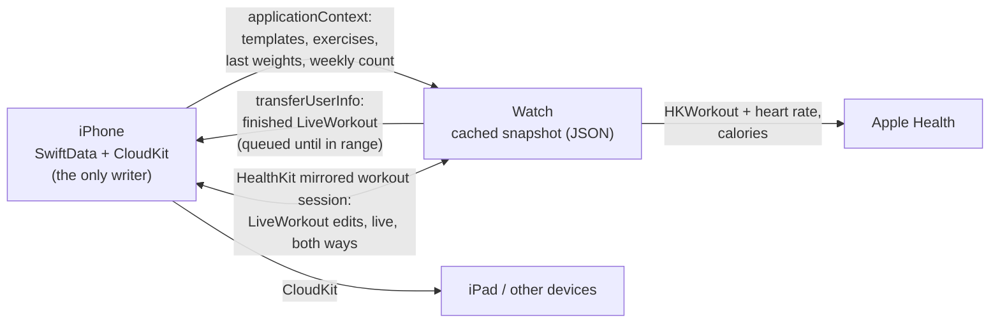

# EPIC_001 — Flex on Apple Watch: start, log and finish a workout from the wrist

**Status:** Drafted 2026-10-30 for the owner's approval. Scope decided with the owner the same day
through the picker (see Decisions). No story is written yet; stories are drafted one at a time,
each approved (UI Mockup included) before its code, in the order below.

## Goal

A lifter can leave the phone in the locker, start a template workout on the watch, log every set
with the Digital Crown or by telling Siri, rest on a wrist-tap timer, and finish. The workout
lands in Flex's History on every device and in Apple Health with heart rate and calories. With the
phone along, the phone and watch show the same workout live, and an edit on one appears on the
other. The epic is done when version 1.1.0 is live on the App Store with the watch app in it and
the owner has logged a real gym session on a real watch (CHORE_002).

## Why

- Logging today means unlocking the phone between every set, with chalky hands, while the phone
  sits on a bench. The watch is already on the wrist.
- The phone has no rest timer. Lifters time rest with another app or not at all. A haptic on the
  wrist when rest ends is the single most useful thing a watch adds for lifting.
- A workout in progress lives only in memory (`@State` in
  `Flex/Flex/Views/Workout/ActiveWorkoutView.swift`) until Finish. If iOS kills Flex mid-workout,
  the workout is gone, and a watch has nothing to read. Fixing that is the foundation for
  everything else, and it helps phone-only users on day one.

## Decisions (owner, 2026-10-30, through the picker)

| Question | Decision |
|---|---|
| What the watch does | Start a template workout on the watch, with no phone needed, **and** mirror a workout running on the phone |
| HealthKit | Yes: a HealthKit workout session on the watch (heart rate, calories, Activity rings). It is also what keeps the app on screen when the wrist drops |
| Rest timer | One timer in the shared workout model, shown on phone and watch, with a wrist haptic when it ends |
| Data path | **The phone is the only writer** of SwiftData and CloudKit. The watch gets a snapshot and sends finished workouts back. A gate holds this (STORY_005) |
| Complication | Yes: one launcher showing workouts this week against the weekly target |
| Siri | One story in this epic: "Log bench press in Flex" asks for the weight and reps, then logs the set, on iPhone or watch |
| Siri, no workout running | Start one, named by time of day as the app does today, then log the set |
| Ticket and gate setup | STORY_001 gives Flex the ticket and gate conventions of the owner's other repos before any watch work |

## How the data moves



- **`LiveWorkout`** is a `Codable` value type in a new shared folder `Flex/FlexShared`, compiled into
  both apps. It holds the title, start time, template it came from, exercises and sets (each set
  has its own UUID), and the rest timer (`restEndsAt`). Every change is a `LiveWorkout.Edit`
  (complete a set, set the weight, add a set, start rest…) applied by one pure function. That
  function is what the tests, the views, the mirror and Siri all use. Each device saves its copy
  as JSON in Application Support, so a closed app resumes where it left off.
- **Exercise identity across devices** is the normalized name (`ExerciseLibrary.normalized`), the
  same key the duplicate merge already uses. `Exercise` has no id, and adding one is a CloudKit
  schema change this epic avoids.
- **Saving is idempotent.** On finish, the phone builds a `Workout` whose existing `id` is set to
  the `LiveWorkout`'s id and skips any id it already has. A finished workout delivered twice is
  saved once. **No SwiftData model changes in this epic**, so there's no CloudKit schema deploy.
  The rest-timer default lives in `PreferencesManager` (iCloud key-value store).
- **Live mirroring** uses HealthKit's mirrored workout session (watchOS 10 / iOS 17 and later).
  The watch runs the `HKWorkoutSession` and mirrors it to the phone, and both sides send edits
  with `sendToRemoteWorkoutSession(data:)`. A workout started on the phone launches the watch app
  with `HKHealthStore.startWatchApp(toHandle:)`. Each field is last-writer-wins on the edit's
  timestamp. New sets never collide because each set has its own UUID.
- Weights stay in **lb**, as `Formatting` is today.

## What it looks like on the wrist (agreed per story; this is the direction)

```
 Home                 Logging a set          Rest
┌──────────────┐     ┌──────────────┐     ┌──────────────┐
│ Flex   2/3 ◔ │     │ ♥ 128  12:41 │     │    REST      │
│ ▶ Push Day   │     │ Bench Press  │     │    1:24      │
│ ▶ Pull Day   │     │ Set 2 of 4   │     │  ◯◯◯◯◯◯◔     │
│ ▶ Legs       │     │  [135] lb  ◀ │     │ Next: 135×8  │
│              │     │    8  reps   │     │ [+15s][Skip] │
│              │     │  [ ✓ Done ]  │     │              │
└──────────────┘     └──────────────┘     └──────────────┘
                       ◀ = Digital Crown focus
```

## Stories, in implementation order

Every story names its Testing Plan layers: unit (`FlexTests`, and `FlexWatchTests` once it
exists), UI/end-to-end (XCUITest in `FlexUITests` / `FlexWatchUITests`, launched with
`FLEX_DEMO`). Any rule a story creates ships with its gate in `scripts/gates/`, run by the
pre-push hook from STORY_001.

### Phase 0 — Flex works like the owner's other repos

| # | Ticket | What it delivers | Gate | Status |
|---|---|---|---|---|
| 1 | STORY_001 — Flex's rules are checked before every push | A Flex `CLAUDE.md` (no story, no code; story, bug, chore, backlog and epic shapes; commit subjects start with the ticket id; anything only the owner can do is a chore), `docs/story`, `docs/bug`, `docs/chore`, `docs/backlog`, `.githooks/pre-push` running every `scripts/gates/*.sh`, and a `commit-msg` hook. Set up with `git config core.hooksPath .githooks`, as in Anchor | `tickets-shape.sh`: file names, plain-English headings, each kind's sections, an epic's three or more stories. `commit-msg` refuses a subject without a ticket id whose file exists | Not started |

### Phase 1 — the phone, shippable on its own

| # | Ticket | What it delivers | Gate | Status |
|---|---|---|---|---|
| 2 | STORY_002 — A workout in progress survives Flex being closed | `LiveWorkout` and its edit function in `Flex/FlexShared`. `ActiveWorkoutView` and `ExerciseSetView` run on it instead of unsaved `@Model` objects. The draft is saved as JSON after every edit and resumed on the next launch. Finish converts it to a `Workout` with the same id | None new. The active-workout views hold `LiveWorkout` values, not models, so the compiler rejects a direct edit. Unit tests cover the edit function and the conversion; a UI test terminates the app mid-workout and checks the relaunch | Not started |
| 3 | STORY_003 — A rest timer counts down between sets | Ticking a set starts rest from a default set in Settings (90 s to start, ±15 s live, Skip). It's shown in the active-workout header, and part of `LiveWorkout`, so the watch inherits it | None new. Unit tests cover the timer edits; a UI test ticks a set and sees the countdown | Not started |

### Phase 2 — the watch

| # | Ticket | What it delivers | Gate | Status |
|---|---|---|---|---|
| 4 | STORY_004 — Flex installs on Apple Watch | A watchOS 11 app target (`kevinbrowncodes.Flex.watchkitapp`) embedded in the iOS app, with `FlexShared` compiled into both, a watch icon from `IconGenerator`, `FLEX_DEMO` on the watch, `FlexWatchTests` and `FlexWatchUITests`. Until a snapshot arrives the watch says "Open Flex on your iPhone to get started" | `shared-is-portable.sh`: `FlexShared` imports no UIKit, SwiftData or CloudKit | Not started |
| 5 | STORY_005 — The watch has your templates and last weights | A `WatchSnapshot` (template folders and templates with their sets, each exercise's last-performed sets, workouts this week and the weekly target) built on the phone and sent with `updateApplicationContext` whenever it changes or Flex comes to the foreground. The watch caches it to disk | `watch-no-swiftdata.sh`: the watch targets never import SwiftData or CloudKit and never create a `ModelContainer`. The message names the rule (the phone is the only writer) and the fix (add it to the snapshot) | Not started |
| 6 | STORY_006 — Start a template on the watch and log sets with the Digital Crown | Home lists the templates. Starting one makes a `LiveWorkout` pre-filled from the last-performed weights. Each exercise is a page; the Crown adjusts the focused weight or reps; Done completes the set and starts rest; Add Set; Finish shows the summary. Works with the phone out of range | None new. Unit tests: pre-fill from the snapshot. Watch UI test: start Push Day, log two sets, finish | Not started |
| 7 | STORY_007 — A workout finished on the watch shows up in History | The finished `LiveWorkout` is queued with `transferUserInfo`. The phone saves it as a `Workout` (idempotent by id), so it reaches the iPad through CloudKit. The watch shows "Saved to iPhone" or "Will save when your iPhone is nearby" | None new. Unit tests: duplicate delivery saves once; an exercise unknown to the phone is matched by normalized name or created as a custom exercise | Not started |
| 8 | STORY_008 — Watch workouts are recorded in Apple Health with heart rate | HealthKit permission on first start, an `HKWorkoutSession` (traditional strength training) plus a builder, heart rate and calories on the logging screen and in the summary, and the `HKWorkout` saved on finish. The session keeps Flex on screen when the wrist drops. Declining permission still lets you log; only the Health parts are gone | `health-usage-strings.sh`: a target with the HealthKit entitlement carries both Health usage strings in its Info.plist. The flex-support privacy page gains a Health section in the same story; App Store Connect's privacy answers are CHORE_001 | Not started |
| 9 | STORY_009 — Phone and watch show the same workout live | Starting on the phone launches the watch through `startWatchApp`; starting on the watch shows it on the phone. Edits flow both ways over the mirrored session, and Finish on either device finishes both. Rest ends with a wrist haptic, and heart rate shows on the phone. If the link drops, each side keeps going and the finish arrives through STORY_007 | None new. Unit tests: merging concurrent edits (same field, last writer wins; sets added on both sides both kept). Two-device behavior is checked by hand in CHORE_002, since a simulator pair can't run a mirrored HealthKit session | Not started |
| 10 | STORY_010 — Siri logs a set on iPhone or Watch | A `LogSetIntent` App Intent in `FlexShared` (exercise, weight in lb, reps) with the phrases "Log \(exercise) in Flex" and "Log a set in Flex". Siri asks for anything not said. Logging fills the exercise's first unfinished set in the live workout (adding the exercise if it's missing), completes it, starts rest and reads back "Logged 135 lb × 8 on Bench Press." With no workout running it starts one by time of day and says so. "Bench press" matching several exercises asks which one, offering the one in the workout first | None new. Unit tests: the intent's effect on `LiveWorkout` for each case (existing unfinished set, all sets done, missing exercise, no workout, ambiguous name). The App Shortcuts phrases are checked at build time by Xcode | Not started |
| 11 | STORY_011 — Weekly progress on the watch face | One WidgetKit accessory complication (circular and corner) showing a ring of workouts this week against the weekly target, from the snapshot. Tapping it opens Flex | None new. Unit test: the ring's value from a snapshot | Not started |

### Phase 3 — ship

| # | Ticket | What it delivers | Gate | Status |
|---|---|---|---|---|
| 12 | STORY_012 — Flex for Apple Watch ships to the App Store | Watch screenshots captured by `ScreenshotTests` on a watch simulator and rendered by `scripts/screenshots.sh`; version 1.1.0 with a new build number; `whats_new` in `appstore/asc_meta.json`; released with ascpilot. Waits on CHORE_001 and CHORE_002 | `watch-screenshots.sh`: `appstore/screenshots/out/watch/` holds PNGs at an App Store Connect watch size | Not started |

### Owner chores (work stops on these; each is cited by the story that waits)

- **CHORE_001 — App Store Connect declares Health data.** The owner updates the App Privacy answers
  (Health & Fitness, not linked to identity, not used for tracking). Blocks STORY_012.
- **CHORE_002 — A real gym session on a real watch.** Through TestFlight, the owner logs one full
  workout from the watch with the phone in the locker, then one mirrored with the phone along, then
  logs a set through Siri on the wrist, and reports what felt wrong. Blocks STORY_012.

## Deferred (not in this epic, on purpose)

- **Adding exercises or building an empty workout on the watch.** Scrolling 226 exercises on a
  watch is miserable; the watch starts from templates or joins the phone's workout. Siri's
  "missing exercise" case is the one exception, because it's named, not scrolled.
- **Editing time and distance sets on the watch.** They show and can be ticked, but are edited on
  the phone.
- **Phone-only workouts in Apple Health.** That needs a workout session on the iPhone, which arrived
  after iOS 18, Flex's deployment target. Revisit when the target moves.
- **A rest timer on the iPhone lock screen** (Live Activity or notification). Only matters for
  phone-only users once the watch exists.
- **Editing history or templates on the watch**, and **kg**.

## Done when

- [ ] Stories 1–12 are Done (Testing Plan tests written, gates green in the pre-push hook).
- [ ] CHORE_001 and CHORE_002 are Done.
- [ ] Flex 1.1.0 with the watch app is live on the App Store.
